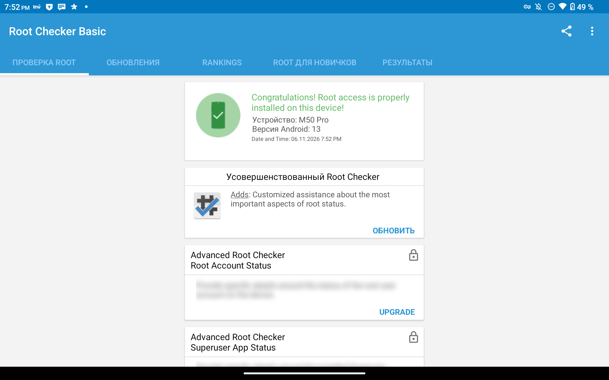
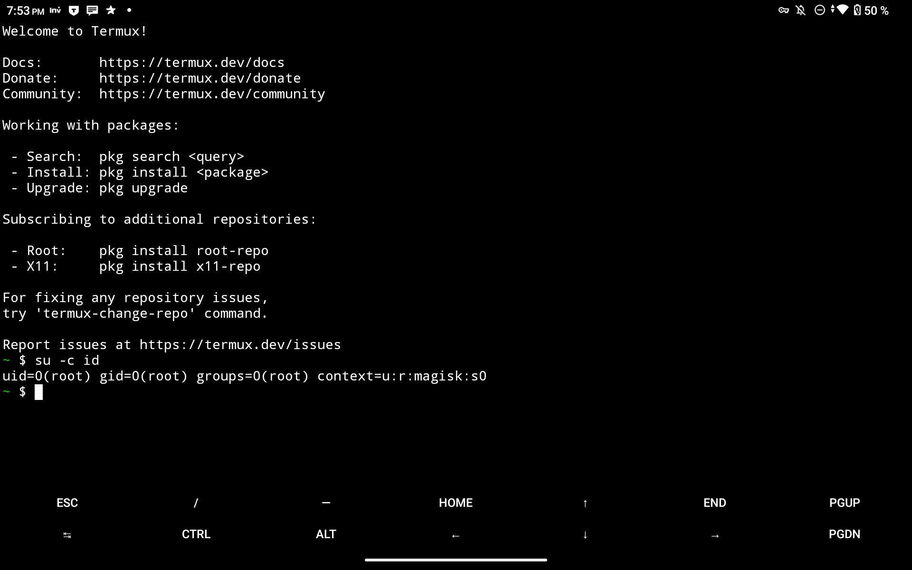
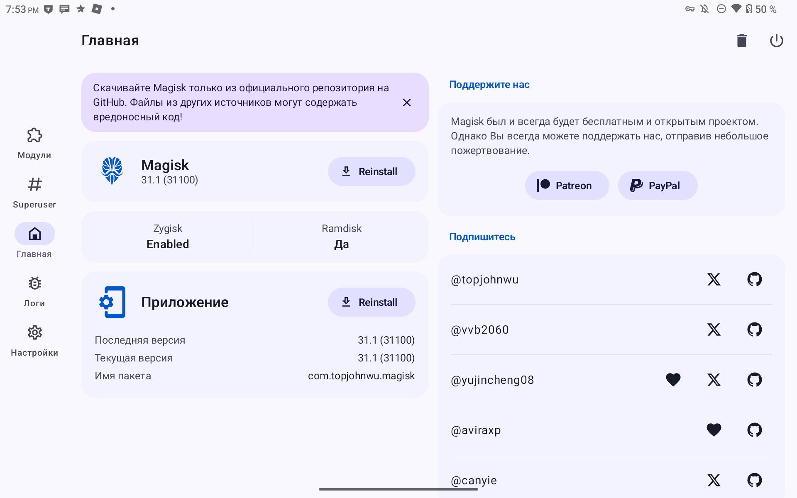

# Root on the Teclast M50 Pro (Unisoc T616 / UMS9230)

**Author:** [xsvebmx](https://github.com/xsvebmx) · [README RU](README.md)

Step-by-step: how to get root on this tablet. The bootloader stays locked; no
unlock is required.

What is used: [CVE-2022-38694](https://nvd.nist.gov/vuln/detail/CVE-2022-38694)
(BootROM code execution, gives full flash access) and
[CVE-2022-38691](https://nvd.nist.gov/vuln/detail/CVE-2022-38691)
(repackaging a modified TOS image so its signature still verifies, which disables
the AVB verdict).

---

## Requirements

| | |
|---|---|
| PC | Windows with PowerShell |
| Cable | USB |
| Firmware | the factory `.rar` containing `Firmware/Firmware.pac` (needed for FDL1/FDL2) |
| `spd_dump.exe` | build of [TomKing062/spreadtrum_flash](https://github.com/TomKing062/spreadtrum_flash) for the **SPRD COM driver** (not libusb) |
| Magisk | APK 31.1+ from [GitHub](https://github.com/topjohnwu/Magisk/releases) |
| Python | 3.8+ for the scripts in `tools/` |

The scripts expect `spd_dump.exe` in `tools/`. If it lives elsewhere, pass
`-SpdDump <path>`.

---

## Step 1. Extract the loaders from the factory firmware

You need `FDL1` and `FDL2`. They are inside `Firmware/Firmware.pac`, so there is no
need to unpack the 3.7 GB archive:

```powershell
python tools\extract_pac.py --rar "path\to\M50 Pro(M4P1)_Android 13.0_EEA_V1.02_20231114_SZ.rar" --out images --names FDL FDL2
```

Result: `images/fdl1-sign.bin` (60 200 bytes) and `images/lk-fdl2-sign.bin`
(1 037 432 bytes). Add `--list` to print every partition in the package.

FDL1 must be patched — its signature check has to go, otherwise the BootROM will
not execute it:

```powershell
python tools\gen_fdl1_dl.py images\fdl1-sign.bin images\fdl1-dl.bin
```

Expected: 60 200 bytes, sha256 `536e3229…1addab`.

FDL2 needs no patching, just rename it to `fdl2.bin`:

```powershell
Copy-Item images\lk-fdl2-sign.bin images\fdl2.bin
```

---

## Step 2. Read the stock partitions from the tablet

You need `sml`, `trustos` and `boot` from your own device.

1. Power the tablet off.
2. Hold **Vol-** and plug in USB, keep holding ~10 s. The screen stays black.
3. Run:

```powershell
cd tools
.\session.ps1 -Action read -OutDir .\dump
```

`tools\dump` will contain `sml_b`, `trustos_b`, `boot_b`. Compare their hashes with
`hashes.txt`: a match means the same firmware, so the images in this repo apply.

If the port does not appear (`find port failed`, `VID_0000&PID_0002`): unplug, hold
Power for 30 s, wait, retry.

---

## Step 3. Build the patched `trustos`

```powershell
python tools\make_tos_noavb.py --slot b --dump tools\dump --out images --spd-dump tools\spd_dump.exe
```

The script finds the AVB check inside TOS, forces its verdict to "success",
repackages the result so the signature still verifies (CVE-2022-38691) and runs ten
checks. Output: `images/tos-noavb-bsp-bypassed_b.bin`, 5 156 744 bytes,
sha256 `03f0c06f…6302`. If the hash differs, do not flash it.

---

## Step 4. Write `trustos`

Put the tablet back into download mode (power off → Vol- → USB → 10 s), then:

```powershell
cd tools
.\session.ps1 -Action write-tos -OutDir .\dump
```

The script writes the image, reads the partition back, compares it byte by byte and
reboots. **If Android boots, the image was accepted.** If not, see Rollback.

---

## Step 5. Patch `boot` with Magisk

`trustos` is patched, so signature checking is off and a modified `boot` will load.

Option A, through the app:

1. `adb push tools\dump\boot_b /sdcard/Download/boot.img`
2. On the tablet: Magisk → Install → "Select and patch a file" → `boot.img`
3. `adb pull /sdcard/Download/magisk_patched-*.img tools\dump\magisk_patched.img`

Option B, without installing the app: extract from the Magisk APK
`lib/arm64-v8a/libmagiskboot.so`, `libmagiskinit.so`, `libmagisk.so`,
`libinit-ld.so` and `assets/boot_patch.sh`, `assets/util_functions.sh`; rename them
to `magiskboot`, `magiskinit`, `magisk`, `init-ld`; put them into
`/data/local/tmp/mpatch` with `boot.img` and run:

```
adb shell su -c "cd /data/local/tmp/mpatch && MAGISKBIN=. TMPDIR=. sh boot_patch.sh boot.img"
adb pull /data/local/tmp/mpatch/new-boot.img tools\dump\magisk_patched.img
```

Sanity check (kernel untouched, ramdisk changed):

```powershell
python tools\check_magisk_patch.py tools\dump\boot_b tools\dump\magisk_patched.img
```

---

## Step 6. Write `boot`

```powershell
cd tools
.\session.ps1 -Action write-boot -Boot .\dump\magisk_patched.img -OutDir .\dump
```

The script writes, verifies and reboots.

---

## Step 7. Verify root

```
adb shell su -c id            → uid=0(root) gid=0(root) context=u:r:magisk:s0
adb shell su -c magisk -v     → 31.1:MAGISK:R
adb shell getprop ro.boot.flash.locked      → 1
adb shell getprop ro.boot.verifiedbootstate → green
```

`su` for `adb shell` is granted in Magisk: Superuser → `+` → enable "System apps" →
"Shell".

---

## Screenshots

Verification on the tablet after installation:

| file | what it should show |
|---|---|
| `docs/img/root-checker.png` | Root Checker: "Congratulations! Root access is properly installed" |
| `docs/img/su-id.png` | terminal: `su -c id` → `uid=0(root) gid=0(root) context=u:r:magisk:s0` |
| `docs/img/magisk.png` | Magisk: version 31.1, `Ramdisk: Yes` |







---

## Rollback

With the tablet in download mode, restore the stock `boot`:

```powershell
.\session.ps1 -Action write-boot -Boot .\dump\boot_b
```

For `trustos`, write `dump\trustos_b` back to the `trustos` partition (the `w
trustos trustos_b` command in the same session).

Full recovery: flash the factory `.pac` with ResearchDownload or UpgradeDownload in
BootROM mode. That mode does not depend on the bootloader state and works even if
the tablet does not start.

---

## Troubleshooting

| symptom | fix |
|---|---|
| tablet will not enter download mode | hold Power 30 s, wait, Vol- + USB |
| `0x8A DOWN_SIZE_ERROR` while loading FDL1 | wrong address; ums9230 needs `0x65000800` |
| session drops at `check baud` | retry; after `reset` wait ~30 s |
| Android does not boot after `trustos` | restore `trustos_b`; make sure the image was built from your own dump |
| no `su` after patching `boot` | run `check_magisk_patch.py`, rebuild from the stock `boot_b` |

Addresses, image formats and the reasoning behind each step are in `docs/en.md`.

---

## Links

- [CVE-2022-38694](https://nvd.nist.gov/vuln/detail/CVE-2022-38694) — Unisoc BootROM code execution
- [CVE-2022-38691](https://nvd.nist.gov/vuln/detail/CVE-2022-38691) — image signature verification bypass
- [TomKing062/CVE-2022-38694_unlock_bootloader](https://github.com/TomKing062/CVE-2022-38694_unlock_bootloader) — original method and address table
- [TomKing062/spreadtrum_flash](https://github.com/TomKing062/spreadtrum_flash) — `spd_dump`
- [topjohnwu/Magisk](https://github.com/topjohnwu/Magisk/releases) — Magisk
