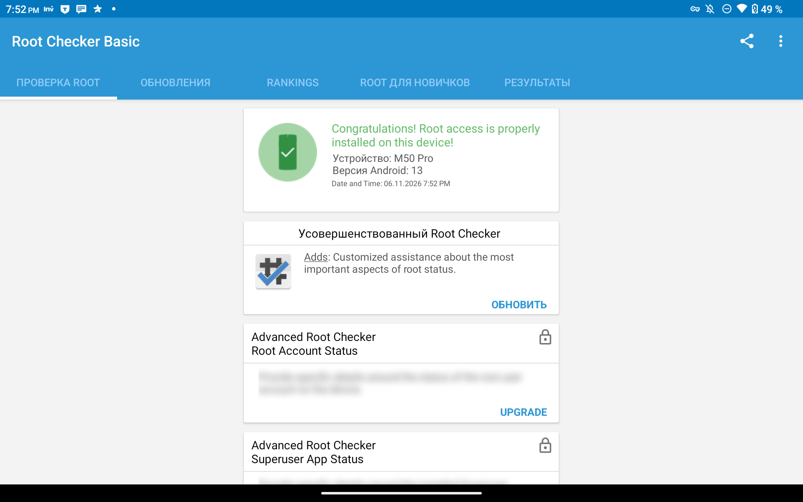
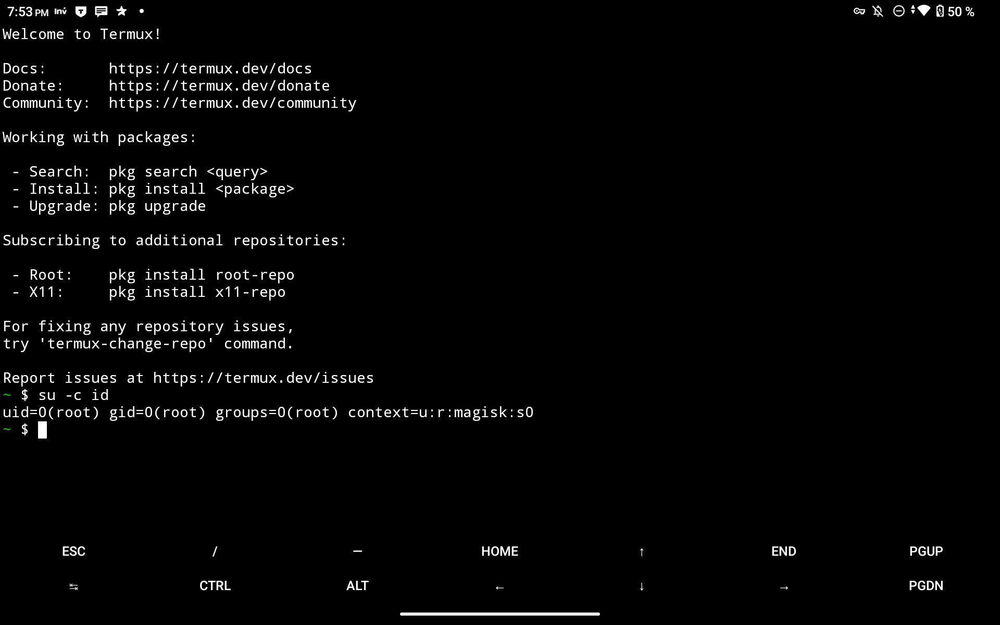
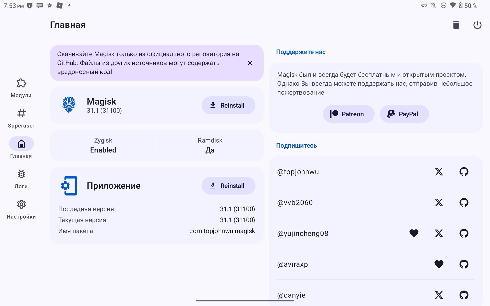

# Root на Teclast M50 Pro (Unisoc T616 / UMS9230)

**Автор:** [xsvebmx](https://github.com/xsvebmx) · [README EN](README.en.md)

Пошаговая инструкция: как получить root на этом планшете. Загрузчик остаётся
заблокированным, разблокировка не требуется.

Что используется: [CVE-2022-38694](https://nvd.nist.gov/vuln/detail/CVE-2022-38694)
(исполнение кода в BootROM, даёт запись во флеш) и
[CVE-2022-38691](https://nvd.nist.gov/vuln/detail/CVE-2022-38691)
(подмена образа TOS с сохранением подписи, снимает проверку AVB).

---

## Что нужно

| | |
|---|---|
| ПК | Windows, PowerShell |
| Кабель | USB |
| Прошивка | заводской архив `.rar` с `Firmware/Firmware.pac` (нужен для FDL1/FDL2) |
| `spd_dump.exe` | сборка [TomKing062/spreadtrum_flash](https://github.com/TomKing062/spreadtrum_flash) **под SPRD COM-драйвер** (не libusb) |
| Magisk | APK 31.1+ с [GitHub](https://github.com/topjohnwu/Magisk/releases) |
| Python | 3.8+ для скриптов из `tools/` |

Скрипты рассчитаны на то, что `spd_dump.exe` лежит в `tools/`. Если он в другом
месте — передавай `-SpdDump <путь>`.

---

## Шаг 1. Достать загрузчики из заводской прошивки

Нужны `FDL1` и `FDL2`. Они лежат в `Firmware/Firmware.pac` внутри заводского
`.rar`. Распаковывать 3.7 ГБ не нужно:

```powershell
python tools\extract_pac.py --rar "путь\к\M50 Pro(M4P1)_Android 13.0_EEA_V1.02_20231114_SZ.rar" --out images --names FDL FDL2
```

Получится `images/fdl1-sign.bin` (60 200 Б) и `images/lk-fdl2-sign.bin`
(1 037 432 Б). Список всех разделов в пакете: добавь `--list`.

FDL1 нужно пропатчить — снять проверку подписи, иначе BootROM откажется его
исполнять:

```powershell
python tools\gen_fdl1_dl.py images\fdl1-sign.bin images\fdl1-dl.bin
```

Ожидаемый результат: 60 200 байт, sha256 `536e3229…1addab`.

FDL2 патчить не надо, просто переименуй его в `fdl2.bin`:

```powershell
Copy-Item images\lk-fdl2-sign.bin images\fdl2.bin
```

---

## Шаг 2. Прочитать разделы планшета

Нужны стоковые `sml`, `trustos` и `boot` именно с твоего экземпляра.

1. Выключи планшет.
2. Зажми **Vol-** и вставь USB, держи ~10 секунд. Экран чёрный — так и должно быть.
3. Запусти:

```powershell
cd tools
.\session.ps1 -Action read -OutDir .\dump
```

В `tools\dump` появятся `sml_b`, `trustos_b`, `boot_b`. Сверь их хеши с
`hashes.txt`: если совпали — прошивка та же, можно идти дальше.

Если порт не поднялся (`find port failed`, `VID_0000&PID_0002`): отключи USB,
зажми Power на 30 секунд, подожди, повтори.

---

## Шаг 3. Собрать патченный `trustos`

```powershell
python tools\make_tos_noavb.py --slot b --dump tools\dump --out images --spd-dump tools\spd_dump.exe
```

Скрипт найдёт в TOS функцию проверки AVB, заменит её вердикт на «успех», упакует
результат так, чтобы подпись сошлась (CVE-2022-38691), и прогонит 10 проверок.
На выходе — `images/tos-noavb-bsp-bypassed_b.bin`, 5 156 744 байт,
sha256 `03f0c06f…6302`. Если хеш не совпал — не прошивай, разбирайся.

---

## Шаг 4. Записать `trustos`

Планшет снова в download mode (Power off → Vol- → USB → 10 сек), затем:

```powershell
cd tools
.\session.ps1 -Action write-tos -OutDir .\dump
```

Скрипт запишет образ, прочитает раздел назад и сверит байт-в-байт, потом
перезагрузит планшет. **Если Android загрузился — образ принят.** Если нет —
откат, см. ниже.

---

## Шаг 5. Пропатчить `boot` через Magisk

`trustos` уже пропатчен, значит проверка подписи отключена — можно ставить
модифицированный `boot`.

Вариант А, через приложение:

1. `adb push tools\dump\boot_b /sdcard/Download/boot.img`
2. На планшете: Magisk → «Установить» → «Выбрать файл и пропатчить» → `boot.img`
3. `adb pull /sdcard/Download/magisk_patched-*.img tools\dump\magisk_patched.img`

Вариант Б, без установки приложения: вытащить из APK Magisk
`lib/arm64-v8a/libmagiskboot.so`, `libmagiskinit.so`, `libmagisk.so`,
`libinit-ld.so` и `assets/boot_patch.sh`, `assets/util_functions.sh`,
переименовать в `magiskboot`, `magiskinit`, `magisk`, `init-ld`, положить в
`/data/local/tmp/mpatch` вместе с `boot.img` и выполнить:

```
adb shell su -c "cd /data/local/tmp/mpatch && MAGISKBIN=. TMPDIR=. sh boot_patch.sh boot.img"
adb pull /data/local/tmp/mpatch/new-boot.img tools\dump\magisk_patched.img
```

Проверка, что патч корректный (ядро не тронуто, рамдиск изменён):

```powershell
python tools\check_magisk_patch.py tools\dump\boot_b tools\dump\magisk_patched.img
```

---

## Шаг 6. Записать `boot`

```powershell
cd tools
.\session.ps1 -Action write-boot -Boot .\dump\magisk_patched.img -OutDir .\dump
```

Скрипт запишет, сверит и перезагрузит.

---

## Шаг 7. Проверить root

```
adb shell su -c id            → uid=0(root) gid=0(root) context=u:r:magisk:s0
adb shell su -c magisk -v     → 31.1:MAGISK:R
adb shell getprop ro.boot.flash.locked      → 1
adb shell getprop ro.boot.verifiedbootstate → green
```

`su` для `adb shell` выдаётся в Magisk: «Superuser» → «+» → включить «Системные
приложения» → «Оболочка» (Shell).

---

## Скриншоты

Проверка на планшете после установки:

| файл | что должно быть на скриншоте |
|---|---|
| `docs/img/root-checker.png` | Root Checker: «Congratulations! Root access is properly installed» |
| `docs/img/su-id.png` | терминал: `su -c id` → `uid=0(root) gid=0(root) context=u:r:magisk:s0` |
| `docs/img/magisk.png` | Magisk: версия 31.1, `Ramdisk: Да` |







---

## Откат

Планшет в download mode, затем вернуть стоковые разделы: `boot` — 

```powershell
.\session.ps1 -Action write-boot -Boot .\dump\boot_b
```

`trustos` — записать `dump\trustos_b` в раздел `trustos` (команда `w trustos
trustos_b` в той же сессии).

Полное восстановление — прошивка заводского `.pac` через ResearchDownload или
UpgradeDownload в режиме BootROM. Этот режим не зависит от состояния загрузчика
и работает, даже если планшет не стартует.

---

## Если что-то пошло не так

| симптом | что делать |
|---|---|
| планшет не входит в download mode | Power 30 сек, пауза, Vol- + USB |
| `0x8A DOWN_SIZE_ERROR` при загрузке FDL1 | неверный адрес, для ums9230 нужен `0x65000800` |
| сессия рвётся на `check baud` | повторить; после `reset` подождать ~30 сек |
| Android не загрузился после `trustos` | вернуть `trustos_b`; проверить, что образ собран из твоих дампов |
| нет `su` после патча `boot` | прогнать `check_magisk_patch.py`, пересобрать из стокового `boot_b` |

Адреса, форматы образов и разбор каждого шага — в `docs/ru.md`.

---

## Ссылки

- [CVE-2022-38694](https://nvd.nist.gov/vuln/detail/CVE-2022-38694) — исполнение кода в BootROM Unisoc
- [CVE-2022-38691](https://nvd.nist.gov/vuln/detail/CVE-2022-38691) — обход проверки подписи образов
- [TomKing062/CVE-2022-38694_unlock_bootloader](https://github.com/TomKing062/CVE-2022-38694_unlock_bootloader) — первоисточник метода, таблица адресов
- [TomKing062/spreadtrum_flash](https://github.com/TomKing062/spreadtrum_flash) — `spd_dump`
- [topjohnwu/Magisk](https://github.com/topjohnwu/Magisk/releases) — Magisk
